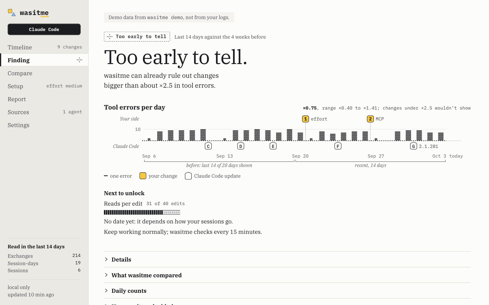

# wasitme

I built `wasitme` to answer a question that kept coming up whenever a coding session started going sideways: **Was it me, or the model?**

`wasitme` is a local command-line tool and macOS menu bar app that reads your local Claude Code and Codex session logs on your Mac, reconstructs a timeline of what changed on your side (model, effort, instruction files, MCP servers, skills) versus what changed on the agent's side (CLI version updates, which model was served), and compares your recent 14 days of sessions against the 28 days before. When at least two different indicator types move in the same direction and the timeline points to one side, it tells you which side moved; otherwise it says **Too early to tell** instead of guessing.

* **Live Web Demo & Film:** [https://draarivpatel-ui.github.io/wasitme/](https://draarivpatel-ui.github.io/wasitme/) ([watch the 37-second walkthrough film](https://draarivpatel-ui.github.io/wasitme/#film))
* **Latest Release (v0.1.0):** [https://github.com/draarivpatel-ui/wasitme/releases/tag/v0.1.0](https://github.com/draarivpatel-ui/wasitme/releases/tag/v0.1.0)



## Quick Install

```sh
curl -fsSL https://github.com/draarivpatel-ui/wasitme/releases/latest/download/install.sh | sh
```

Or if you prefer to read the install script before running it:

```sh
curl -fsSLO https://github.com/draarivpatel-ui/wasitme/releases/latest/download/install.sh
less install.sh
sh install.sh
```

[`scripts/install.sh`](scripts/install.sh) fetches the release tarball, verifies its SHA-256 checksum against [`SHA256SUMS`](https://github.com/draarivpatel-ui/wasitme/releases/latest/download/SHA256SUMS), and walks through the install steps one by one (using [`scripts/lib/`](scripts/lib/), [`jsonutil.mjs`](scripts/lib/jsonutil.mjs), and [`from-app.mjs`](scripts/lib/from-app.mjs)). You can also pass `--dry-run` to preview every file write without changing anything.

Requirements: **Node.js 22 or newer** ([D24](docs/DECISIONS.md)). On macOS, if you have Swift 6 / Xcode Command Line Tools 16+, the installer also builds the native macOS menu bar app from source and signs it ad hoc ([D7](docs/DECISIONS.md)).

| Platform | Command line | Background scan | Hooks, plugin, status line | Mac app |
|---|---|---|---|---|
| macOS, Apple silicon | yes | yes | yes | built locally |
| macOS, Intel | yes | yes | yes | builds for the host; untested |
| Linux | yes | none: scans when you run it | hooks do nothing, harmlessly | none |
| Windows | not supported until the npm package is published ([D16](docs/DECISIONS.md)) | | | |

## What It Reads and Privacy Rules

> **Local only.** No network code. Only the installer downloads, and only when you run it. No account, no telemetry.

* It reads your local Claude Code and Codex session logs in read-only mode, plus a short list of agent config files (stored only as counts and salted hashes) and six fixed-name project setup files at session start.
* It keeps only counts, durations, short allow-listed labels, and salted hashes. It **never** stores prompt text, reply text, tool inputs/outputs, source code, file paths, project names, or secrets.
* It never opens `auth.json` or `.credentials.json`, and never executes any hook, skill, or MCP command it discovers.
* Anything you explicitly run inside Claude Code or Codex (`/wasitme`, `/wasitme:report`) becomes part of that chat session and is sent to Anthropic or OpenAI like any normal message. Those reports contain numbers only.
* Full details are in [docs/PRIVACY.md](docs/PRIVACY.md) and [SECURITY.md](SECURITY.md).

The optional Claude Code in-session mod ([observed](docs/spikes/2026-10-04-claude-plugin.md)) is restricted by [`check-mod-allowlist.mjs`](scripts/check-mod-allowlist.mjs) and [`check-calls.mjs`](plugin/tests/check-calls.mjs) to reading `~/.wasitme/glance.json` and drawing its status pane:

```
calls: clock.every, clock.now, command.register, fs.read, fs.stat, state.get, state.set, ui.close, ui.open, ui.resolve
```

## The Five Possible Findings

Every surface (CLI, macOS menu bar popover, desktop panel, and Control Center) shows one horizontal line with your changes above it (square) and the agent's updates below it (triangle):

| Mark | You see | What it means |
|---|---|---|
| Dashed line, two dots | **Too early to tell** | Not enough sessions in both windows to compare yet. `wasitme` shows what is still needed (for example, `31 of 40 edits so far`). |
| Bare line | **No detectable change** | Both windows have enough data, and changes larger than the stated threshold would have shown up. |
| Square above, triangle below | **Can't tell which** | Indicators shifted, but both sides changed around the same time or indicators moved in opposite directions. |
| Square above the line | **Your side** | Your indicators shifted around the time of a configuration or workflow change on your side, with nothing on the agent's side explaining it. |
| Triangle below the line | **Agent side** | Nothing recorded changed on your side, while the agent's side updated (a different model served or a CLI update across projects). |

Two additional states are **Timeline only** and **Out of date** (when the last scan is too old to call current). Because a single person's logs are noisy, **Too early to tell** is common on purpose ([D10](docs/DECISIONS.md), [D54](docs/DECISIONS.md), [D66](docs/DECISIONS.md)), and `wasitme` keeps derived numbers even after Claude Code's 30-day transcript cleanup ([research notes](docs/research/03-claude-code-plugins-mods.md)).

## Command Line Usage

* `wasitme` prints the current findings and timeline summary.
* `wasitme status` prints a single status line (`wasitme statusline install --wrap` and `wasitme statusline uninstall` manage the shell/editor status line).
* `wasitme report` generates a shareable numbers-only report (`--md` by default, or `--html`). Passing `--json` or `report --format json` outputs the raw machine-readable snapshot for local scripts; because that JSON includes exact timestamps and local IDs, it is **not** safe to share publicly.
* `wasitme demo` renders sample output on synthetic data so you can explore the UI right away.
* `wasitme scan` runs an immediate log scan.
* `wasitme history status` shows how many saved history files and bytes are stored locally, and `wasitme history clear` resets saved history while keeping settings and exclusions.
* `wasitme exclude` excludes specific dates, projects, or entrypoints from analysis.
* `wasitme doctor --redacted` prints a redacted diagnostic summary for bug reports.
* `wasitme update` prints instructions for updating your installation.

## How the Statistical Gate Works & Honest Limits

`wasitme` compares tool errors, reads per edit, and edits without reading first between the latest 14-day window and the prior 28-day baseline, printing a plausible range for each ratio. Details on the statistical gates and confounders are in [docs/METHOD.md](docs/METHOD.md) ([status at a glance](docs/METHOD.md#status-at-a-glance)).

On synthetic calibration runs following 7,000 simulated users for 90 days with no real change (`1,000` in each of seven profiles), zero false changes or false agent-side findings fired (a 95% upper bound of `0.37%` per profile). For power on a planted 2x regression ([METHOD.md](docs/METHOD.md#what-the-calibration-runs-so-far-show)), detection succeeded in `34 to 39 of 40` runs for active multi-session profiles, and in `7 to 10 of 40` runs for sparse-failure, few-long-session, or Codex profiles (9 of 40 on Codex).

Important limitations to keep in mind:
* Indicators measure tool friction (errors, read/edit ratios), not whether code or prose answers were good. Every finding ends with: "These indicators don't measure answer quality. Evidence, not proof."
* Plugin-only and `--until` reports leave out your configuration history because they run read-only without loading saved snapshots.
* Codex has no session hooks, so some days are not fully observed; `$wasitme:report` is not yet confirmed on a live Codex login ([D49](docs/DECISIONS.md)).
* Updating (`curl -fsSL https://github.com/draarivpatel-ui/wasitme/releases/latest/download/install.sh | sh -s -- --update`) or uninstalling (`sh ~/.wasitme/current/scripts/uninstall.sh`) never touches your underlying Claude or Codex logs ([how to delete everything](docs/PRIVACY.md#how-to-delete-everything)).

## Repository Links & License

See [Contributing](CONTRIBUTING.md), [Security](SECURITY.md), [Code of Conduct](CODE_OF_CONDUCT.md), [Formats](docs/FORMATS.md), and [Third-party notices](THIRD_PARTY_NOTICES.md). Inspired in part by community analyses in [anthropics/claude-code issue #42796](https://github.com/anthropics/claude-code/issues/42796).

Licensed under the [MIT License](LICENSE) ([D2](docs/DECISIONS.md), [D15](docs/DECISIONS.md), [D27](docs/DECISIONS.md)).
